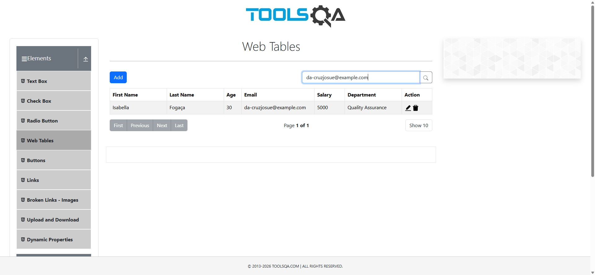
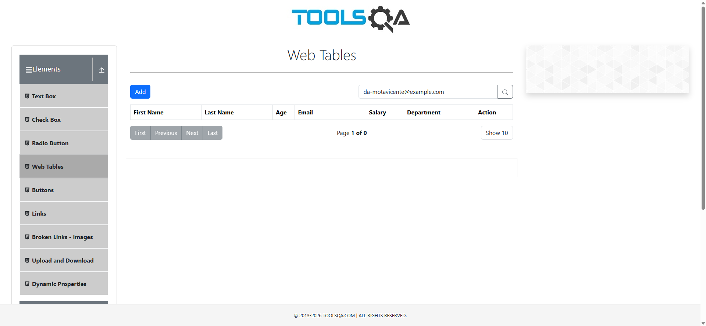

QA Accenture | Automação de Testes Web com Python
Projeto de automação de testes funcionais de interface web desenvolvido com Python, Selenium WebDriver e Pytest, utilizando o DemoQA como ambiente de prática.
O projeto contempla cadastro, pesquisa, edição, exclusão e validação de campos. A implementação utiliza Page Object Model (POM), geração de dados fictícios e coleta de evidências, com foco na organização dos cenários, na execução reproduzível e na rastreabilidade dos resultados.
Resultado da regressão de 20/10/2026: 8 testes aprovados, 0 falhas e 100% de aprovação.
Tecnologias utilizadas
Tecnologia	Finalidade
Python 3.13.13	Linguagem de automação utilizada na execução registrada
Selenium WebDriver	Interação com o navegador e validação da interface
Pytest 9.1.1	Execução, organização e asserções dos testes
Faker 40.43.0	Geração de dados fictícios
pytest-html 4.2.0	Geração de relatórios HTML
Google Chrome / ChromeDriver	Navegador e automação via WebDriver
PowerShell e VS Code	Execução e desenvolvimento no Windows
Aplicação sob teste
DemoQA — Web Tables: https://demoqa.com/webtables
Os testes utilizam dados fictícios e verificam o comportamento da aplicação de demonstração. Como o ambiente é externo, alterações na interface ou indisponibilidade do serviço podem afetar futuras execuções.
Estrutura do projeto
```text
QA_ACCENTURE_PYTHON/
├── pages/
│   └── web_tables_page.py
├── tests/
│   ├── test_web_tables.py
│   ├── test_web_tables_cenarios.py
│   └── test_practice_form.py
├── evidencias/
│   ├── crud/
│   │   ├── 01_cadastro_original.png
│   │   ├── 02_salario_atualizado.png
│   │   ├── 03_email_atualizado.png
│   │   └── 04_registro_excluido.png
│   ├── screenshots/
│   ├── CT06_email_invalido.png
│   ├── relatorio_crud_email_final.html
│   └── relatorio_regressao_final.html
├── backups/
├── conftest.py
├── pytest.ini
└── README.md
```
Cenários automatizados
Identificador	Objetivo	Resultado na última regressão
CRUD principal	Criar, consultar, atualizar salário e e-mail e excluir um registro	PASSED
CT-01	Cadastrar registro e validar sua criação	PASSED
CT-02	Pesquisar registro cadastrado	PASSED
CT-03	Atualizar salário de um registro	PASSED
CT-04	Excluir registro	PASSED
CT-05	Validar campos obrigatórios	PASSED
CT-06	Rejeitar e-mail em formato inválido	PASSED
A tabela apresenta o CRUD principal e os seis cenários CT-01 a CT-06. A execução completa registrada pelo Pytest coletou 8 testes, incluindo uma execução adicional no arquivo `tests/test_practice_form.py`. As etapas do CRUD são verificações realizadas dentro de um mesmo teste, não testes Pytest independentes.
Fluxo do CRUD principal
CREATE: cadastrar registro fictício com salário inicial de `5000`.
READ: validar nome, sobrenome, e-mail e salário do registro criado.
UPDATE — salário: alterar o valor de `5000` para `6500` e validar a alteração.
UPDATE — e-mail: substituir o e-mail original por outro endereço fictício distinto.
READ: confirmar o novo e-mail, o salário `6500` e a preservação dos demais campos.
DELETE: excluir o registro utilizando o novo e-mail e confirmar sua ausência.
As verificações utilizam asserções automatizadas e mensagens de acompanhamento no terminal.
Organização do código
O projeto adota o padrão Page Object Model (POM) para centralizar os seletores e as operações da página em `pages/web_tables_page.py`.
`tests/`: cenários automatizados e respectivas validações.
`pages/`: ações e seletores da aplicação sob teste.
`conftest.py`: configuração compartilhada do Pytest e captura automática de evidências.
`pytest.ini`: configuração da execução dos testes.
`evidencias/`: imagens e relatórios gerados durante as execuções.
Essa separação favorece legibilidade, manutenção e reaproveitamento das operações da interface.
Preparação do ambiente
Pré-requisitos: Python, Google Chrome e PowerShell no Windows.
Na raiz do projeto, crie e ative o ambiente virtual:
```powershell
python -m venv .venv
.\.venv\Scripts\Activate.ps1
```
Instale as bibliotecas principais:
```powershell
python -m pip install selenium pytest faker pytest-html
```
Caso exista um `requirements.txt` atualizado no repositório, também é possível instalar as dependências com:
```powershell
python -m pip install -r requirements.txt
```
A disponibilidade e a configuração do ChromeDriver devem ser compatíveis com o navegador instalado e com a configuração utilizada pelo projeto.
Executando os testes
Suíte completa com relatório HTML
```powershell
$env:DEMO_DELAY = "1.5"

python -m pytest tests/ -v -s `
    --html=evidencias/relatorio_regressao_final.html `
    --self-contained-html
```
CRUD principal
```powershell
python -m pytest tests/test_web_tables.py -v -s `
    --html=evidencias/relatorio_crud_email_final.html `
    --self-contained-html
```
Cenários CT-01 a CT-06
```powershell
python -m pytest tests/test_web_tables_cenarios.py -v -s
```
A variável `DEMO_DELAY` habilita pausas opcionais implementadas no Page Object para facilitar o acompanhamento visual. As pausas não substituem as esperas explícitas do Selenium.
Evidências e relatórios
Capturas por etapa do CRUD
Arquivo	Etapa registrada
`evidencias/crud/01_cadastro_original.png`	Registro criado e validado
`evidencias/crud/02_salario_atualizado.png`	Salário alterado para `6500`
`evidencias/crud/03_email_atualizado.png`	Novo e-mail e salário confirmados
`evidencias/crud/04_registro_excluido.png`	Registro excluído
Cadastro realizado

Atualização do salário

Atualização do e-mail

Exclusão do registro

Evidências automáticas
O projeto também salva screenshots por teste em `evidencias/screenshots/`, com identificação do teste, resultado e horário. Na regressão registrada, o terminal confirmou a incorporação dessas imagens ao relatório HTML.
Relatórios disponíveis na estrutura apresentada:
`evidencias/relatorio_crud_email_final.html`
`evidencias/relatorio_regressao_final.html`
As quatro capturas específicas do CRUD utilizam nomes fixos e são substituídas em novas execuções. Para manter um histórico, arquive-as antes de executar novamente.
Resultado da regressão — 20/10/2026
Indicador	Resultado
Sistema operacional	Windows 11
Python	3.13.13
Pytest	9.1.1
Testes coletados	8
Testes aprovados	8
Falhas	0
Taxa de aprovação	100%
Tempo de execução	217,30 s (3min 37s)
Relatório	`evidencias/relatorio_regressao_final.html`
A suíte concluiu a regressão registrada com todos os testes aprovados, geração automática de evidências e relatório HTML para consulta dos resultados.
Sobre o projeto
Este repositório demonstra práticas de automação de testes de interface web, estruturação de cenários, validação de resultados, manutenção de Page Objects e produção de evidências. Os dados utilizados nos cadastros são fictícios e gerados exclusivamente para fins de teste.